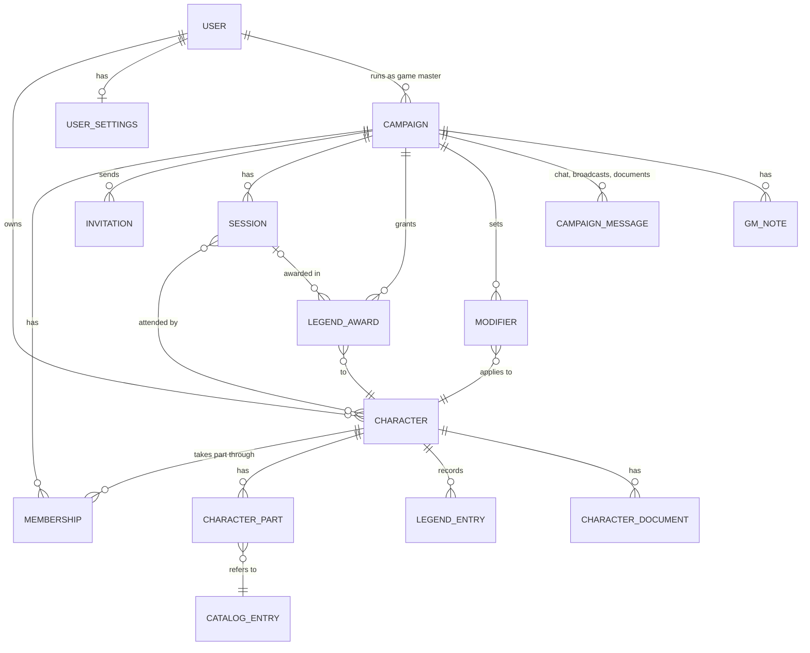

# Data model

An overview of the core objects and how they relate. It is derived from the database schema documentation in the backend repository (status of the test database, 2026-11-19) and simplified: one box stands for an object, not for a table.

## Core objects

| Object | What it is |
|---|---|
| **User** | An account with e-mail address and password. Signing in requires a confirmed e-mail address. Tokens for e-mail confirmation and password reset belong to the user. |
| **User settings** | Per-user settings, among them the encrypted Anthropic API key of a game master. |
| **Character** | Name, race, up to two disciplines with their circles, base attribute values. Owned by one user (by user ID, see [ADR 0012](../adr/0012-characters-linked-by-user-id.md)). |
| **Character parts** | Everything that makes up a character sheet: current and derived values, talent ranks per discipline, skills, knacks, spells and spell matrices, foreign spells through versatility, special talents, weapons, armor, equipment and loot, dice macros, animal companions, picture, personal description, comments on values. |
| **Legend entries** | The character's legend point history, earned and spent. |
| **Character documents** | Free documents per character. Stored as Markdown files, not in the database (see [ADR 0013](../adr/0013-character-documents-as-markdown-files.md)). |
| **Catalog** | Reference data from the Earthdawn rules: disciplines, races and their attribute modifiers, talents per discipline and circle, skills, spells, knacks, passions, weapons, armor, equipment. |
| **Campaign** | Run by a user in the role of game master. Has a real start date, an in-game calendar and a maximum number of players. |
| **Membership** | A character's participation in a campaign, with a status (active, inactive, left). |
| **Invitation** | An invitation to a campaign by e-mail, with a token and an expiry date. |
| **Session** | A game session of a campaign, with date, in-game days and attending characters. |
| **Legend award** | Legend points that the game master awards to a character, optionally linked to a session. The player claims them into the character's legend. |
| **Modifier** | An attribute change that the game master sets for a character in a campaign. |
| **Campaign messages** | Chat between game master and player, broadcasts to all players, and documents for one character or all; read receipts per character. |
| **Game master notes** | Notes on NPCs, locations and free notes, with tags. |

## Integrity

- 60 tables, all InnoDB with `utf8mb4` (**observed** on the test database, 2026-11-19).
- Only the relations of campaigns are enforced as foreign keys in the database: deleting a campaign removes its memberships, invitations, sessions, awards, modifiers, chat and messages. A character that is still a member of a campaign cannot be deleted at database level.
- All other relations, for example between a character and its parts, are kept consistent by the code, for example when a character is deleted.
