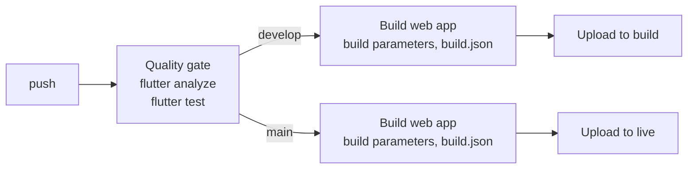
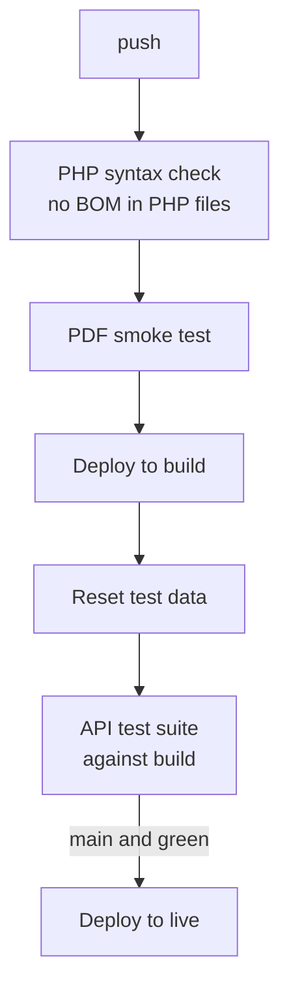

# Environments and CI/CD

## Environments

| Environment | App | API | Fed from |
|---|---|---|---|
| Build (test) | https://build.edchar.schuchi.eu | https://build.edchar.schuchi.eu/api/ | branch `develop` |
| Live | https://edchar.schuchi.eu | https://edchar.schuchi.eu/api/ | branch `main` |

Both environments run on the same web hosting, each with its own folder, its own database and its own configuration file. The configuration file holds the database credentials and the key used to encrypt the AI keys. It is not part of any repository. The API reads it from a folder outside the web root, with the old location inside the API folder as a fallback (see [ADR 0015](../adr/0015-securing-the-web-root.md)).

The app finds its API through a build parameter (`BASE_URL`). Without it, the app uses the live API.

## Pipelines

Both repositories use GitHub Actions. Every push to `develop` or `main` starts a run. Deployment copies the files to the server.

### Frontend

- The quality gate runs on the CI runner. The tests run in a browser, because parts of the app use browser functions.
- The build writes a build ID into the app and into a file `build.json` next to it (see [Versions and build ID](versioning.md)).
- Only the build output is uploaded, no source or developer files.
- Runs per branch wait for each other, so an older run never overwrites a newer state.

### Backend

- **Lint:** every PHP file is checked for syntax errors and for a byte order mark, which would corrupt the JSON responses.
- **PDF smoke test:** the PDF generator runs once with a fixed test character.
- **Deploy to build:** also on a push to `main`, so the exact state that goes live is tested first.
- **API test suite:** resets the test data on build, then runs 649 checks (**observed**, 2026-11-07). Credentials and test IDs come from GitHub secrets.
- **Live lock:** the deploy to live only runs on `main` and only if the suite is green. There is no bypass (see [ADR 0008](../adr/0008-api-tests-after-every-deploy.md)).
- **No overlap:** all runs share one queue for the build server.
- **Not uploaded:** tests, documentation, the API contract, CLAUDE.md, workflow files and the test data reset script (live only).

## Going live

A merge to `main` happens only during a GoLive, in a fixed order: backend first, then frontend. See [GoLive](../showcase/golive.md).
