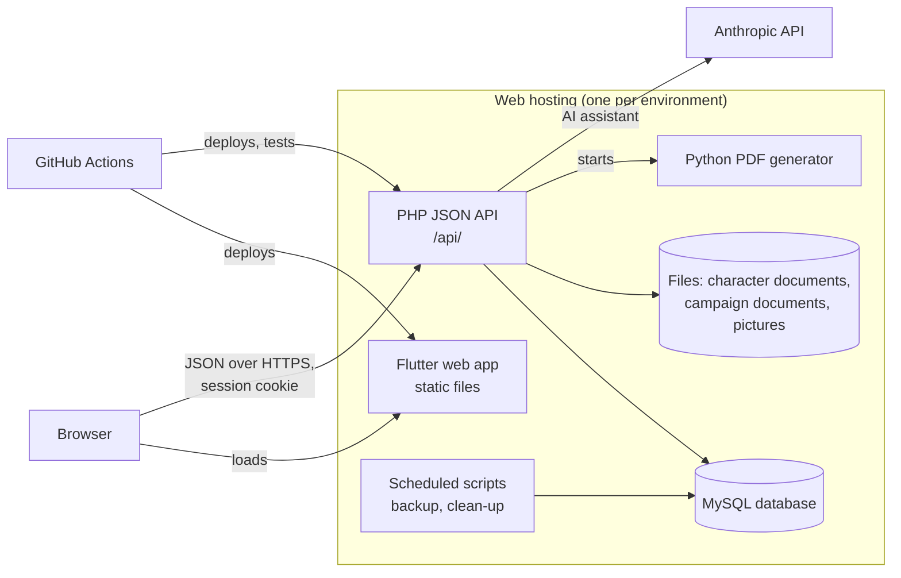

# Architecture

How the parts of EDChar fit together.

!!! info "Evidence"
    Unless marked otherwise, the statements in this section are **derived from the code** and configuration on the `develop` branches of both code repositories, as of 2026-11-20. Statements marked **observed** were checked against the running system.

## System overview

The app and the API are served from the same domain. The app lives at the root, the API under `/api/`. There are two such environments, build and live (see [Environments and CI/CD](environments.md)).

## Components

| Component | Technology | Repository | Role |
|---|---|---|---|
| Web app | Flutter / Dart, target platform web | Frontend | User interface for players and game masters. Calls the API over HTTP. Built into static files and uploaded. |
| API | PHP, JSON | Backend | Accounts and sign-in, characters and all their parts, campaigns and game master functions, character documents, PDF export, AI assistant. 201 documented endpoints (183 distinct paths), see [Facts and figures](../showcase/facts.md). |
| PDF export | Python with `pdfrw` and `reportlab` | Backend | The API writes the character data to a temporary file and starts the Python script. The script fills six PDF form templates (A4) and adds the character picture. The API returns the finished PDF. |
| Database | MySQL | – | 60 tables, all InnoDB with `utf8mb4` (**observed** on the test database, 2026-11-19). The schema is documented in the backend repository. |
| File storage | Server file system | – | Character documents as Markdown files, one folder per character (see [ADR 0013](../adr/0013-character-documents-as-markdown-files.md)); campaign documents; character pictures. Documents are delivered through endpoints that check access. |
| AI assistant | Anthropic Messages API | Backend | The game master's request goes to the API, which calls the Anthropic API with the game master's own key (model `claude-haiku-4-5`). The key is stored encrypted per game master. |
| Scheduled scripts | Shell and PHP scripts | Backend | Database backup and clean-up jobs, run by the hosting's scheduler. |

## Structure of the code

**Frontend** (`lib/`):

| Folder | Content |
|---|---|
| `models/` | Data models (character, talents, skills, spells, campaign …) |
| `utils/` | API access through a shared request helper, global state, rule and helper functions, build information, update check |
| `views/` | Pages and areas of the app (account, game master, login, player …) and popups |
| `widgets/` | Reusable UI building blocks |
| `l10n/` | Translations (ARB files) |

**Backend**: one folder per area (`char/`, `talents/`, `spells/`, `gm/`, `player/`, `meta/` …), each endpoint a PHP file. All signed-in endpoints start with a shared bootstrap that sets up CORS, the session check, the JSON header and the database connection (see [ADR 0010](../adr/0010-consolidating-a-grown-api.md)).

## The API contract

Frontend and backend agree on field names, responses and error codes in an API contract maintained in the backend repository. Dart uses camelCase, PHP uses snake_case; names are not converted automatically and are checked against the contract (see [ADR 0011](../adr/0011-charkey-at-the-interface.md)). All responses use one format: `success` plus `data` or `error`. The contract itself is internal and not published here.

## More on

- [API overview](api.md)
- [Data model](data-model.md)
- [Environments and CI/CD](environments.md)
- [Authentication and ownership](security.md)
- [Multiple languages](i18n.md)
- [Versions and build ID](versioning.md)
