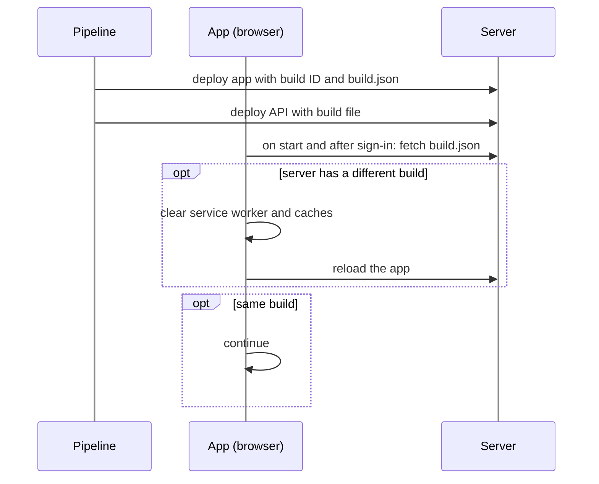

# Versions and build ID

EDChar distinguishes between a readable version number and a build ID (see [ADR 0007](../adr/0007-one-version-per-golive.md)).

| | Version number | Build ID |
|---|---|---|
| Example | v2.4.0 | date, time and short commit hash |
| Changes | once per GoLive | on every deploy |
| Set by | the Board-Keeper, in ticket 27 | the pipeline |
| Stored in | `pubspec.yaml` (app) and the changelog (API) | the app build and a file `build.json` next to it; a build file for the API |

## How it works

1. **Build ID in the app.** The frontend pipeline passes the build ID, the channel (build or live) and the version number from `pubspec.yaml` to the build. It also writes `build.json` with the same build ID.
2. **Build ID in the API.** The backend pipeline writes a build file on every deploy. The endpoint `meta/get_build.php` returns build ID, branch and version.
3. **Display.** The app shows the version of the last GoLive with both build IDs, for example "v2.4.0 · Build …". On live, the build details are shown on click.
4. **Update check.** When the app starts and after a successful sign-in, it compares its own build ID with `build.json` on the server. If the server has a different build, the app clears the service worker and the browser caches and reloads. If that does not help, it asks the user to press Ctrl+F5. It does not check while in use, because deployments do not happen during use.
5. **Cache headers** make the browser check the app files before use.

## Changelog

The backend keeps one changelog for app and API. New changes go into a section "Unreleased (Build)". At the GoLive, Backend renames it to the new version number. The app shows the changelog in the user account.
