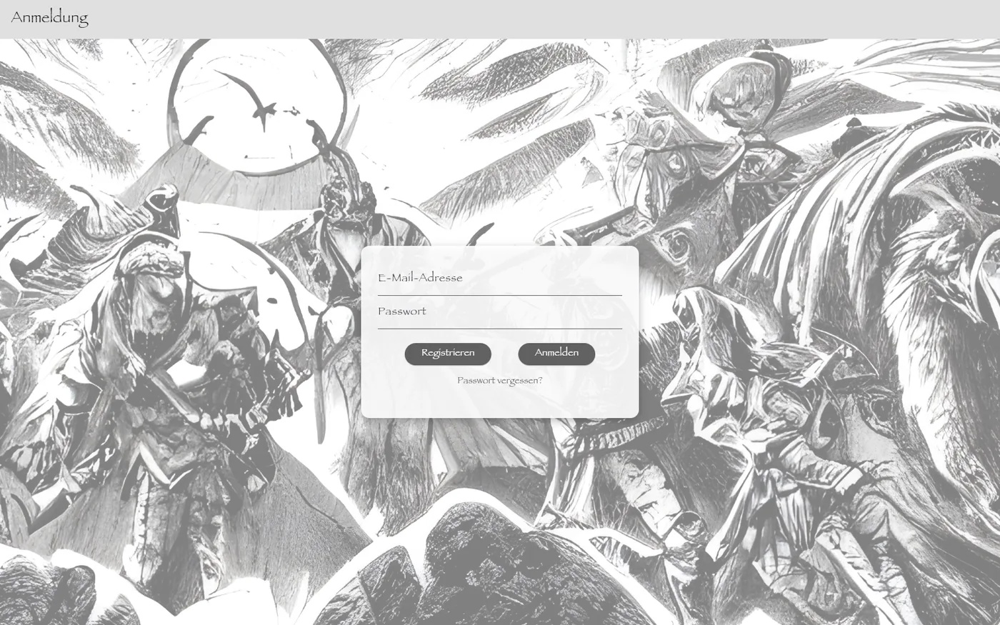
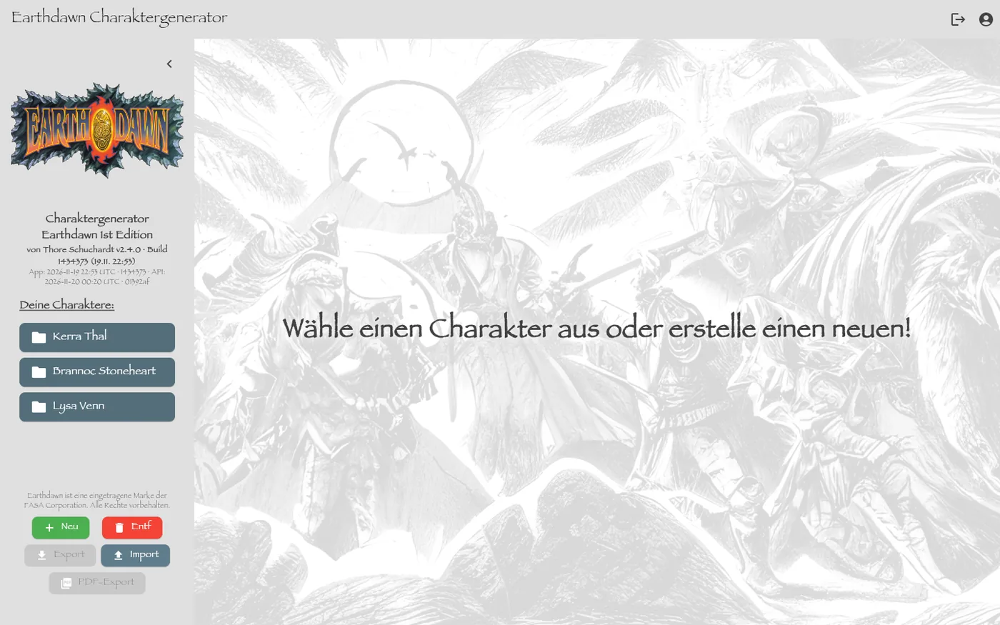
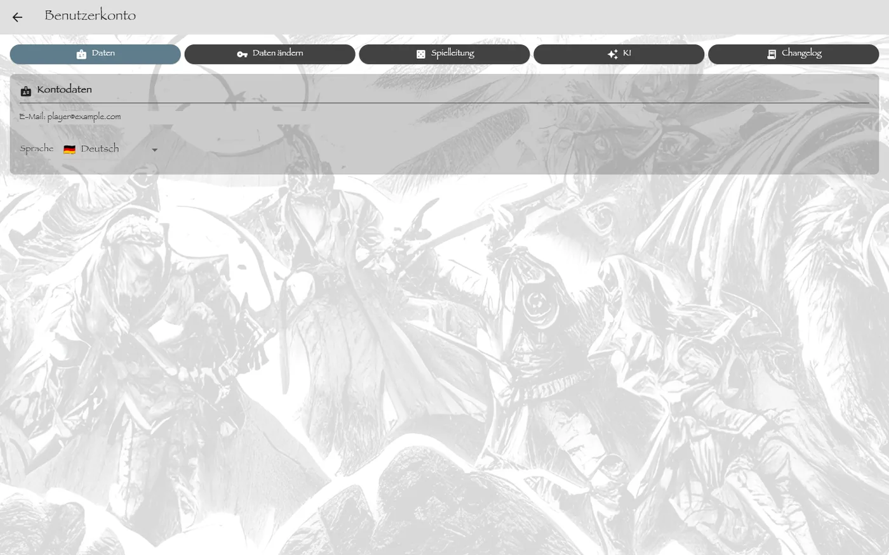

# Handbuch

Dieses Handbuch erklärt die Bedienung von EDChar. Es geht um die App, nicht um die Regeln von Earthdawn.

- **[Spieler](spieler.md):** Charaktere anlegen und verwalten, der Charakterbogen, einer Kampagne beitreten.
- **[Spielleiter](spielleiter.md):** Kampagnen führen, Spieler einladen, Legendenpunkte vergeben, der KI-Assistent.

Die Beschriftungen in diesem Handbuch sind die, die die App bei deutscher Spracheinstellung zeigt.

## Erste Schritte

### Registrieren

1. Öffne die App. Die Seite **Anmeldung** erscheint.
2. Gib deine E-Mail-Adresse und ein Passwort (mindestens 6 Zeichen) ein und klicke auf **Registrieren**.
3. Die Seite **Registrierung erfolgreich!** erscheint. Prüfe dein Postfach und klicke auf den Bestätigungslink in der E-Mail.
4. Die Seite **E-Mail-Verifizierung** bestätigt deine Adresse mit **E-Mail bestätigt!**. Danach kannst du dich anmelden.

Versuchst du dich vor der Bestätigung anzumelden, zeigt die App *Bitte bestätige zuerst deine E-Mail-Adresse. Prüfe dein Postfach.*

[{ loading=lazy }](../assets/screenshots/de/start-sign-in.webp)

### Anmelden und Abmelden

Gib auf der Seite **Anmeldung** deine E-Mail-Adresse und dein Passwort ein und klicke auf **Anmelden**. Zum Abmelden klickst du oben rechts auf das Abmelde-Symbol (Tooltip **Abmelden**).

### Passwort vergessen?

1. Klicke auf der Seite **Anmeldung** auf **Passwort vergessen?**.
2. Gib deine E-Mail-Adresse ein und klicke auf **Senden**. Ist die Adresse registriert, erhältst du einen Link zum Zurücksetzen.
3. Der Link öffnet die Seite **Passwort zurücksetzen**. Gib unter **Neues Passwort vergeben** ein neues Passwort ein.
4. Klicke auf **Zur Anmeldung** und melde dich mit dem neuen Passwort an.

## Der Bildschirm

Nach der Anmeldung siehst du links die Seitenleiste und rechts den Hauptbereich.

- **Seitenleiste:** deine Charaktere, im Spielleiter-Modus deine Kampagnen. Mit den Pfeil-Buttons blendest du sie aus und ein (Tooltips **Seitenleiste ausblenden** und **Seitenleiste einblenden**). Das hilft auf kleinen Bildschirmen.
- **Oben rechts:** das Symbol für das Benutzerkonto (Tooltip **Benutzerkonto**) und **Abmelden**.
- **Spieler / Gamemaster:** Hast du in deinem Konto den Spielleiter-Modus eingeschaltet, erscheint ein Schalter zwischen **Spieler** und **Gamemaster**. Siehe [Spielleiter](spielleiter.md#spielleiter-modus-einschalten).

[{ loading=lazy }](../assets/screenshots/de/start-home.webp)

## Dein Konto

Klicke oben rechts auf das Symbol für das Benutzerkonto. Die Seite **Benutzerkonto** hat diese Bereiche:

| Bereich | Was du dort tun kannst |
|---|---|
| **Daten** | Deine **Kontodaten** (**E-Mail**) ansehen und die **Sprache** der App wählen (**Englisch** oder **Deutsch**). Die Auswahl merkt sich die App in diesem Browser. |
| **Daten ändern** | **E-Mail-Adresse ändern**: die **Neue E-Mail-Adresse** eingeben, unter **Neue E-Mail bestätigen** wiederholen und auf **E-Mail ändern** klicken. An die neue Adresse geht ein Bestätigungslink, die Änderung wird erst nach der Bestätigung wirksam. **Passwort ändern**: die Felder **Aktuelles Passwort**, **Neues Passwort** und **Passwort bestätigen** ausfüllen, dann auf **Passwort speichern** klicken. |
| **Spielleitung** | Den Spielleiter-Modus einschalten mit *Nutzt du die App auch als Spielleiter?* |
| **KI** | Einen eigenen Anthropic API Key für den KI-Assistenten der Spielleitung hinterlegen. Siehe [Spielleiter](spielleiter.md#ki-assistent). |
| **Changelog** | Was sich in welcher Version der App geändert hat. |

[{ loading=lazy }](../assets/screenshots/de/account-data.webp)

## Updates

Beim Öffnen der App und nach der Anmeldung prüft die App, ob eine neuere Version vorliegt, und lädt sich dann selbst neu. Klappt das nicht, zeigt sie *Neue Version verfügbar, bitte Strg+F5 drücken.* Drücke dann Strg+F5, um die neue Version zu laden.
