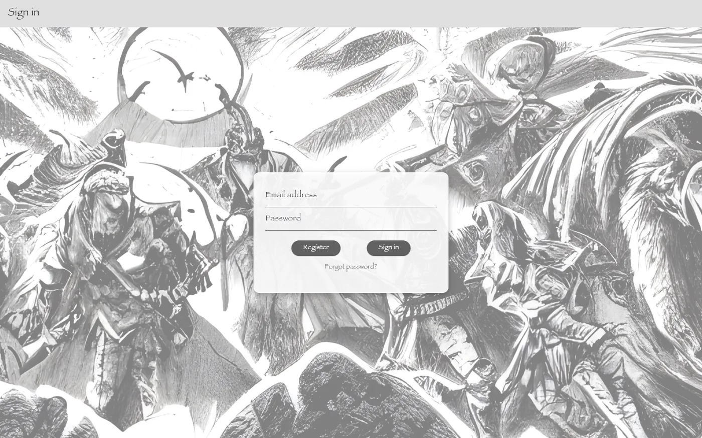
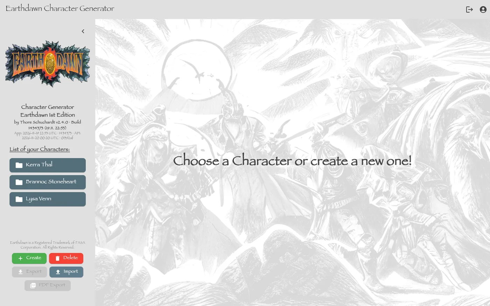
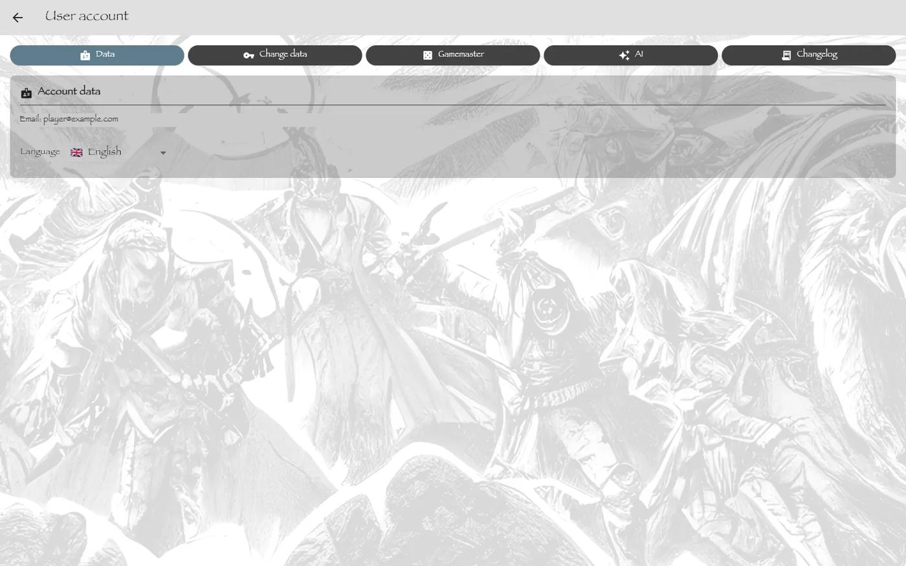

# Handbook

This handbook explains how to use EDChar. It covers operating the app, not the rules of Earthdawn.

- **[Players](spieler.md):** creating and managing characters, the character sheet, joining a campaign.
- **[Game Masters](spielleiter.md):** running campaigns, inviting players, awarding legend points, the AI assistant.

The labels in this handbook are the ones the app shows when its language is set to English. The German version of this handbook uses the German labels.

## Getting started

### Registering

1. Open the app. The page **Sign in** appears.
2. Enter your email address and a password (at least 6 characters) and click **Register**.
3. The page **Registration successful!** appears. Check your inbox and click the confirmation link in the email.
4. The page **Email verification** confirms your address with **Email confirmed!**. You can now sign in.

If you try to sign in before confirming, the app shows *Please confirm your email address first. Check your inbox.*

[{ loading=lazy }](../assets/screenshots/en/start-sign-in.webp)

### Signing in and out

Enter your email address and password on the page **Sign in** and click **Sign in**. To sign out, click the logout icon (tooltip **Logout**) at the top right.

### Forgot your password?

1. On the page **Sign in**, click **Forgot password?**.
2. Enter your email address and click **Send**. If the address is registered, you receive a link to reset your password.
3. The link opens the page **Reset password**. Enter a new password under **Set a new password**.
4. Click **Back to sign in** and sign in with the new password.

## The screen

After signing in you see the sidebar on the left and the main area on the right.

- **Sidebar:** your characters, or your campaigns in game master mode. Hide and show it with the arrow buttons (tooltips **Hide sidebar** and **Show sidebar**). This is useful on small screens.
- **Handbook:** below the version line in the sidebar. Opens this handbook in a new tab, in the language set in the app.
- **Top right:** the user account icon (tooltip **User account**) and **Logout**.
- **Player / Gamemaster:** if you have switched on game master mode in your account, a switch between **Player** and **Gamemaster** appears. See [Game Masters](spielleiter.md#activating-game-master-mode).

[{ loading=lazy }](../assets/screenshots/en/start-home.webp)

## Your account

Click the user account icon at the top right. The page **User account** has these sections:

| Section | What you can do there |
|---|---|
| **Data** | See your **Account data** (**Email**) and choose the app **Language** (**English** or **German**). The choice is remembered in this browser. |
| **Change data** | **Change email address**: enter the **New email address** twice and click **Change email**. A confirmation link is sent to the new address; the change takes effect once you confirm it. **Change password**: enter the **Current password** and the **New password** twice, then click **Save password**. |
| **Gamemaster** | Switch on game master mode with *Do you use the App as DungeonMaster as well?* |
| **AI** | Store your own Anthropic API key for the AI assistant of game masters. See [Game Masters](spielleiter.md#ai-assistant). |
| **Changelog** | What changed in which version of the app. |

[{ loading=lazy }](../assets/screenshots/en/account-data.webp)

## Updates

When you open the app or sign in, it checks whether a newer version is available and reloads itself if so. If that does not work, the app shows *New version available, please press Ctrl+F5.* Press Ctrl+F5 to load the new version.
