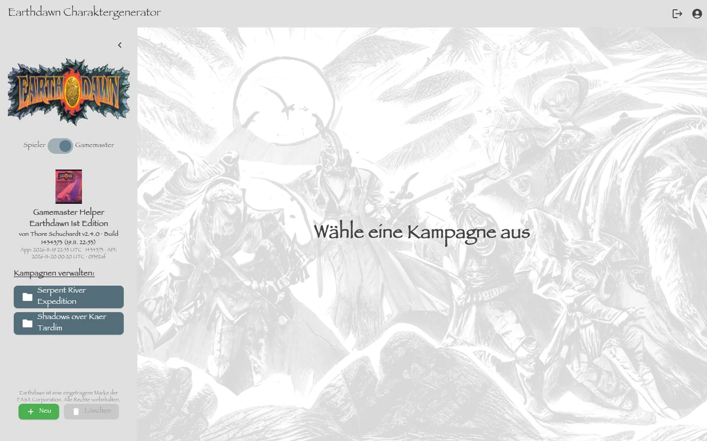
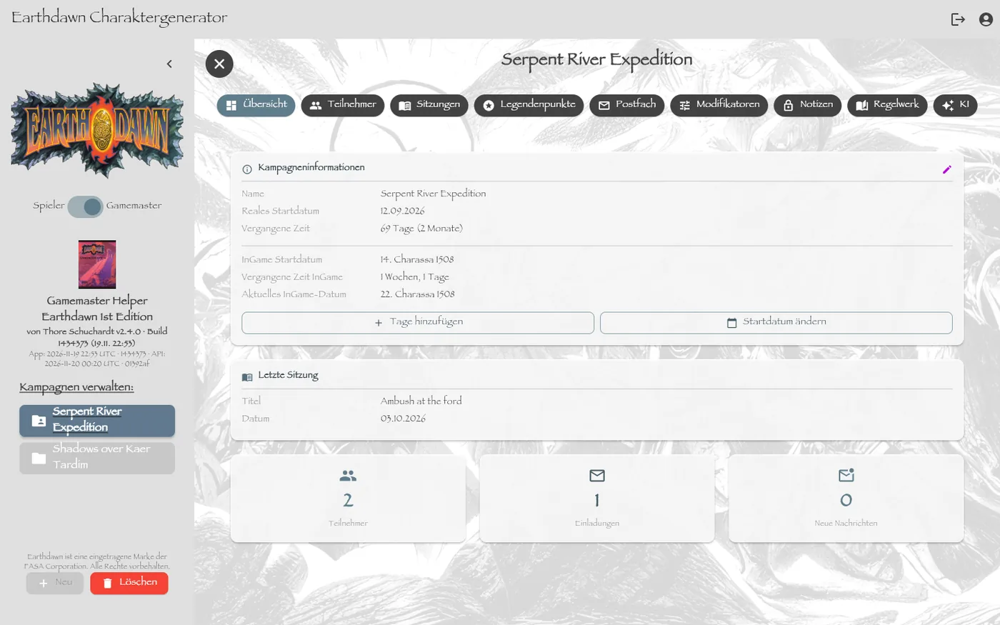
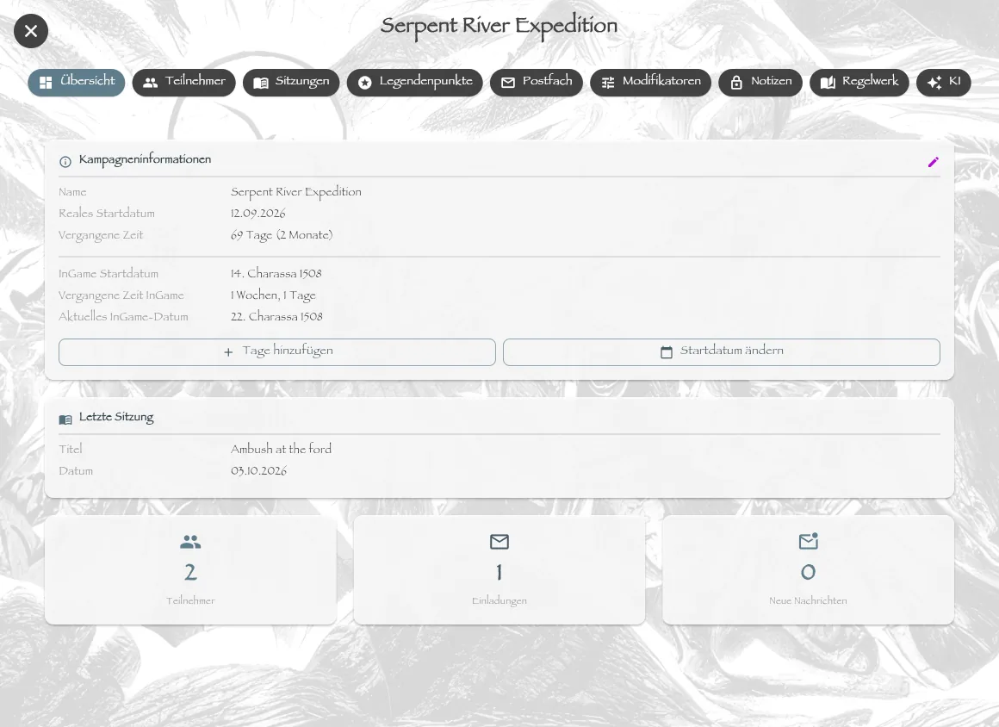
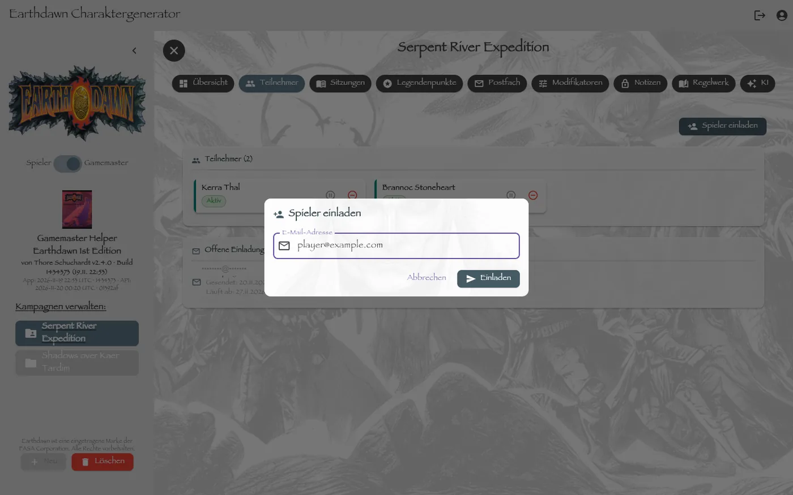
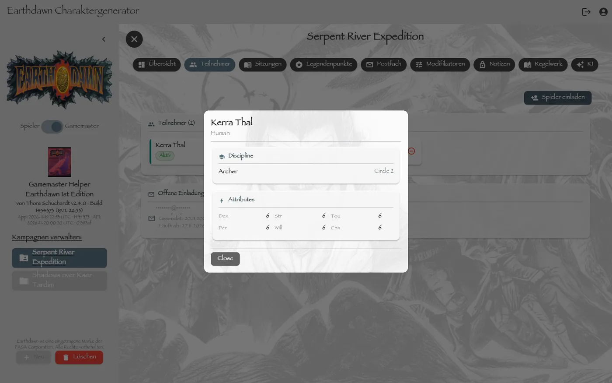
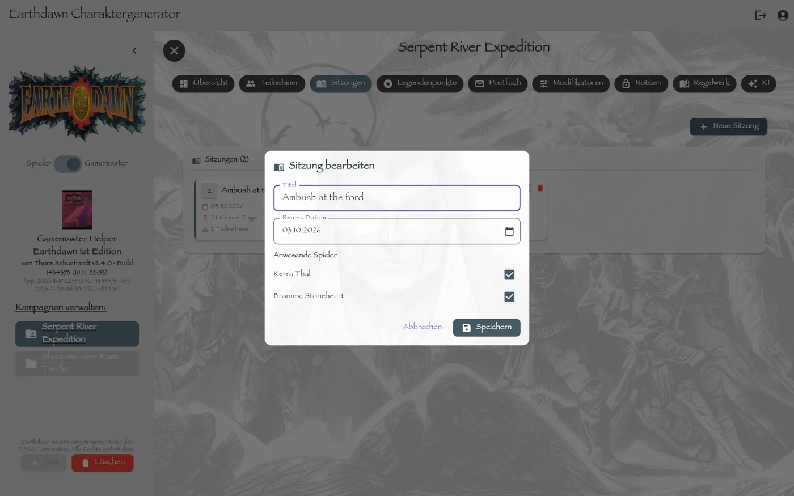
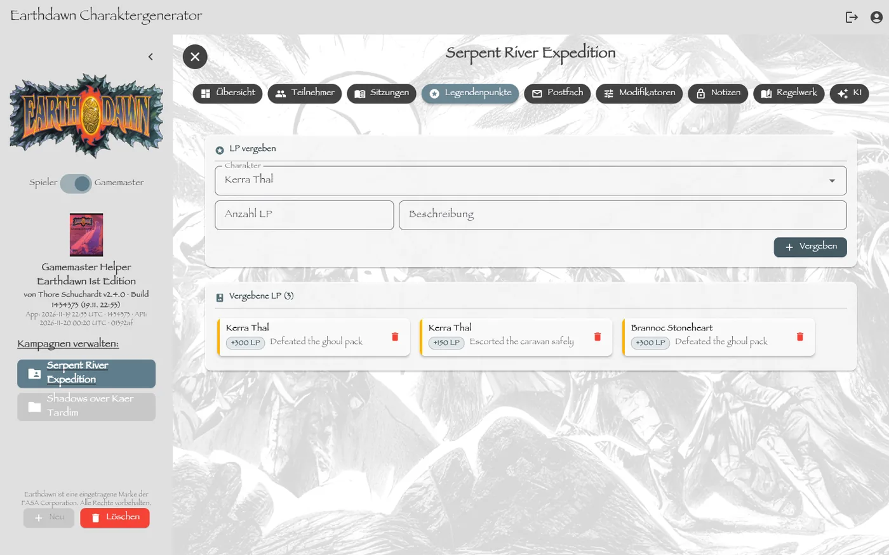
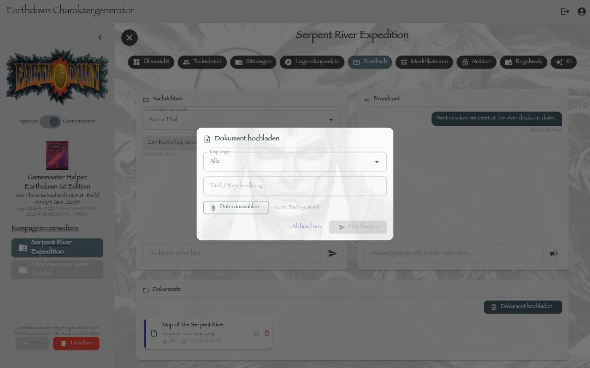
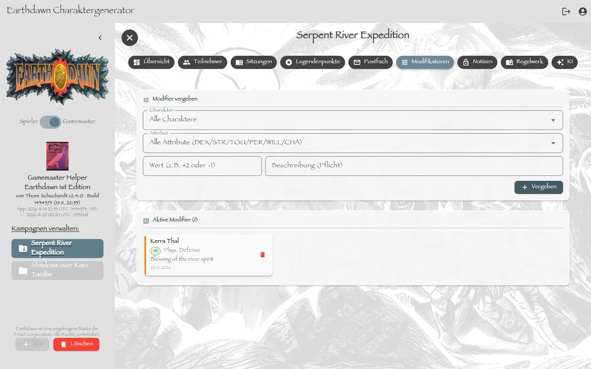
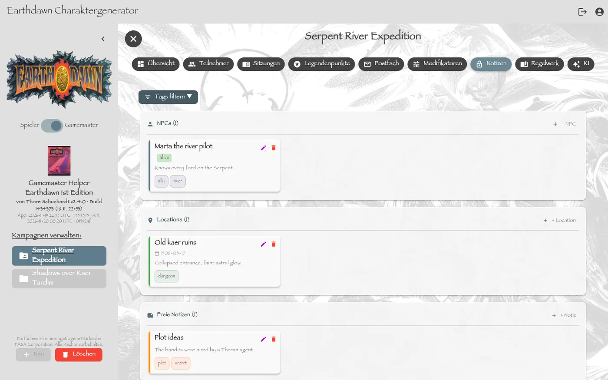

# Spielleiter

## Spielleiter-Modus einschalten

1. Öffne mit dem Symbol oben rechts dein Benutzerkonto.
2. Schalte im Bereich **Spielleitung** *Nutzt du die App auch als Spielleiter?* ein. Die App bestätigt *Gamemaster aktiviert!*.
3. Zurück auf dem Hauptbildschirm erscheint ein Schalter zwischen **Spieler** und **Gamemaster**. Stelle ihn auf **Gamemaster**.

Im Spielleiter-Modus zeigt die Seitenleiste **Gamemaster Helper Earthdawn 1st Edition** und **Kampagnen verwalten:**.

[{ loading=lazy }](../assets/screenshots/de/gm-switch.webp)

## Kampagnen

- **Neu** öffnet **Neue Kampagne anlegen**. Gib den **Kampagnenname** ein, wähle mit **Startdatum wählen** das Startdatum und klicke auf **Anlegen**.
- Ein Klick auf eine Kampagne in der Liste öffnet sie.
- **Löschen** löscht eine Kampagne nach der Rückfrage **Kampagne löschen?**. Das lässt sich nicht rückgängig machen.

Eine offene Kampagne hat diese Reiter: **Übersicht**, **Teilnehmer**, **Sitzungen**, **Legendenpunkte**, **Postfach**, **Modifikatoren**, **Notizen**, **Regelwerk** und **KI**.

[{ loading=lazy }](../assets/screenshots/de/gm-campaign-tabs.webp)

## Übersicht

- **Kampagneninformationen:** **Reales Startdatum**, **Vergangene Zeit**, **InGame Startdatum**, **Vergangene Zeit InGame** und **Aktuelles InGame-Datum**. **Kampagne bearbeiten** ändert **Kampagnenname**, das reale Startdatum und **Max. Spieler**.
- **Startdatum ändern** setzt das InGame-Startdatum (**Jahr**, **Monat**, **Tag**). **Tage hinzufügen** stellt das InGame-Datum vor.
- **Letzte Sitzung:** Titel und Datum der letzten Sitzung.
- Zähler für **Teilnehmer**, **Einladungen** und **Neue Nachrichten**.

[{ loading=lazy }](../assets/screenshots/de/gm-overview.webp)

## Teilnehmer

### Spieler einladen

1. Klicke auf **Spieler einladen**.
2. Gib die **E-Mail-Adresse** des Spielers ein und klicke auf **Einladen**. Die App bestätigt **Einladung gesendet**.
3. Der Spieler bekommt eine E-Mail mit einem Link und nimmt die Einladung mit einem seiner Charaktere an.

Offene Einladungen stehen unter **Offene Einladungen** mit **Gesendet:** und **Läuft ab:**. Abgelaufene Einladungen sind mit **Abgelaufen** markiert, mit **Frist verlängern** verlängerst du sie. **Einladung widerrufen** zieht eine Einladung zurück.

[{ loading=lazy }](../assets/screenshots/de/gm-invite.webp)

### Teilnehmer verwalten

Die Liste **Teilnehmer** zeigt jeden Charakter mit **Beigetreten:** und Status.

- **Deaktivieren** und **Aktivieren** schalten einen Teilnehmer zwischen aktiv und inaktiv um.
- **Aus Kampagne entfernen** entfernt einen Charakter nach einer Rückfrage.
- Charaktere, die die Kampagne verlassen haben, sind mit **Verlassen** markiert.
- Ein Klick auf einen Teilnehmer öffnet eine Schnellansicht des Charakters mit Bild, Disziplin und Attributen.

[{ loading=lazy }](../assets/screenshots/de/gm-participants.webp)

## Sitzungen

- **Neue Sitzung** legt eine Sitzung mit **Titel**, **Reales Datum**, **Vergangene InGame-Tage** und **Anwesende Spieler** an.
- Die Liste **Sitzungen** zeigt jede Sitzung mit InGame-Tagen und Teilnehmern. Bearbeiten mit dem Stift (Tooltip **Bearbeiten**) oder löschen.
- **InGame-Tage nachtragen** ergänzt die InGame-Tage einer Sitzung nachträglich.

[{ loading=lazy }](../assets/screenshots/de/gm-sessions.webp)

## Legendenpunkte

1. Wähle unter **LP vergeben** einen **Charakter** oder **Alle Charaktere**.
2. Gib **Anzahl LP** und **Beschreibung** ein und klicke auf **Vergeben**.

Vergebene Legendenpunkte stehen unter **Vergebene LP** und lassen sich dort löschen. Die Spieler übernehmen sie in ihrem Reiter **Kampagne**. Charaktere, die die Kampagne verlassen haben, bekommen keine Legendenpunkte.

[{ loading=lazy }](../assets/screenshots/de/gm-legend-points.webp)

## Postfach

- **Nachrichten:** wähle mit **Charakter auswählen** einen Charakter, um seinen Chat zu lesen und zu beantworten. Im Bereich **Broadcast** schreibst du eine Ankündigung an alle Spieler (*Ankündigung an alle Spieler schreiben...*) und schickst sie mit **An alle Spieler senden** ab. Die Spieler sehen sie unter **Ankündigungen**.
- **Dokumente:** **Dokument hochladen** teilt eine Datei. Wähle den **Empfänger** (einen Charakter oder **Alle**), gib **Titel / Beschreibung** ein, wähle mit **Datei auswählen** die Datei und klicke auf **Hochladen**. Die Spieler sehen die Dokumente unter **Dokumente vom GM**. Hochgeladene Dokumente lassen sich wieder löschen.

[{ loading=lazy }](../assets/screenshots/de/gm-mailbox.webp)

## Modifikatoren

Modifikatoren verändern Attribute von Charakteren, zum Beispiel als Wirkung eines Fluchs oder Segens.

1. Wähle unter **Modifier vergeben** einen **Charakter** oder **Alle Charaktere**.
2. Wähle ein **Attribut** oder **Alle Attribute (DEX/STR/TOU/PER/WILL/CHA)**.
3. Gib unter **Wert (z.B. +2 oder -1)** den Wert und unter **Beschreibung (Pflicht)** eine Beschreibung ein und klicke auf **Vergeben**.

Aktive Modifikatoren stehen unter **Aktive Modifier** und lassen sich dort löschen. Die Spieler sehen den Modifikator an ihrem Charakter mit dem Zusatz *von GM* und dem Kampagnennamen.

[{ loading=lazy }](../assets/screenshots/de/gm-modifiers.webp)

## Notizen

Der Reiter **Notizen** sammelt Notizen in drei Bereichen: **NPCs**, **Locations** und **Freie Notizen**.

- **Neu** in einem Bereich legt eine Notiz mit **Titel**, **Status** (bei NPCs), **InGame-Datum**, **Inhalt** und Tags (**Tag hinzufügen**) an.
- Bearbeiten und Löschen geht über die Symbole daneben.
- **Tags filtern** zeigt nur Notizen mit bestimmten Tags. **Zurücksetzen** hebt den Filter auf.

[{ loading=lazy }](../assets/screenshots/de/gm-notes.webp)

## Regelwerk

Der Reiter **Regelwerk** zeigt die **Regelwerk-Tabellen** und dieselben Werkzeuge wie der Charakterbogen: **Würfeln** und die Suche nach Disziplinen, Passionen, Talenten und Zaubern. Siehe [Spieler](spieler.md#wurfeln-und-info-suche).

## KI-Assistent

Der KI-Assistent erzeugt NPCs, Dialoge und Orte. Er nutzt deinen eigenen Anthropic API Key.

1. Gib in deinem Konto im Bereich **KI** deinen Anthropic API Key ein und klicke auf **Speichern**. Den Key findest du unter console.anthropic.com. Ist ein Key hinterlegt, zeigt der Bereich **✅ API Key hinterlegt**. **Löschen** entfernt ihn.
2. Öffne in der Kampagne den Reiter **KI**. Die Seite **AI-Assistent** erscheint.
3. Wähle **NPC**, **Dialog** oder **Ort**.
4. Gib bei Bedarf **Zusätzliche Hinweise (optional)** ein, zum Beispiel *ein Schmied in Throal, misstrauisch*.
5. Klicke auf **Generieren**. Darunter erscheint das **Ergebnis**. **Kopieren** kopiert es in die Zwischenablage.

