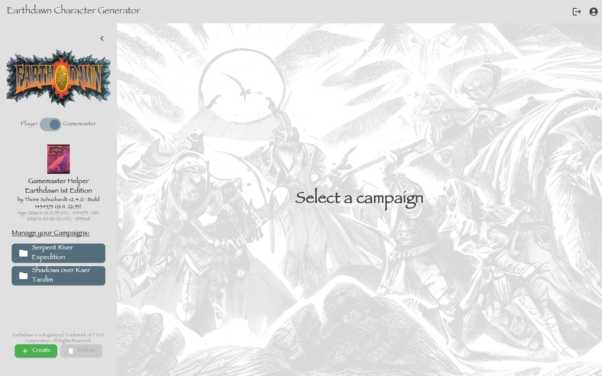
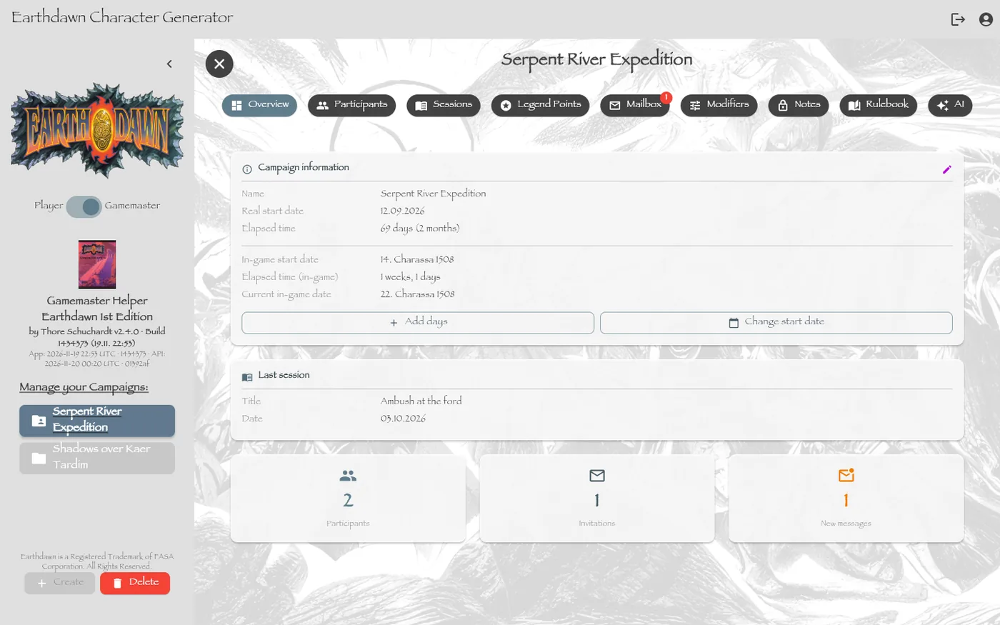
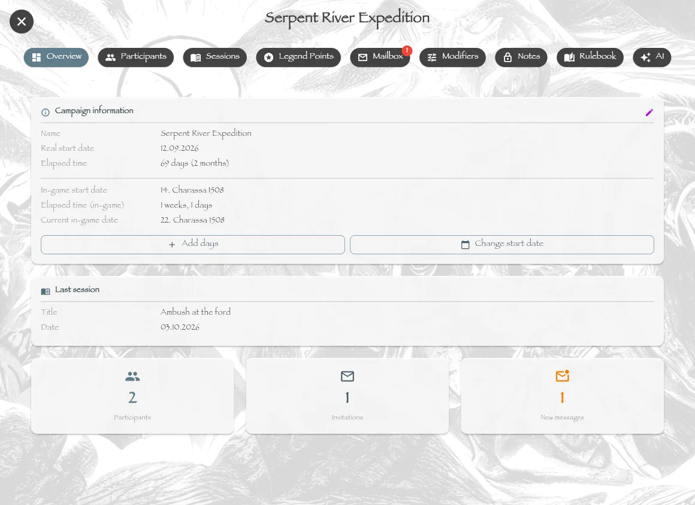
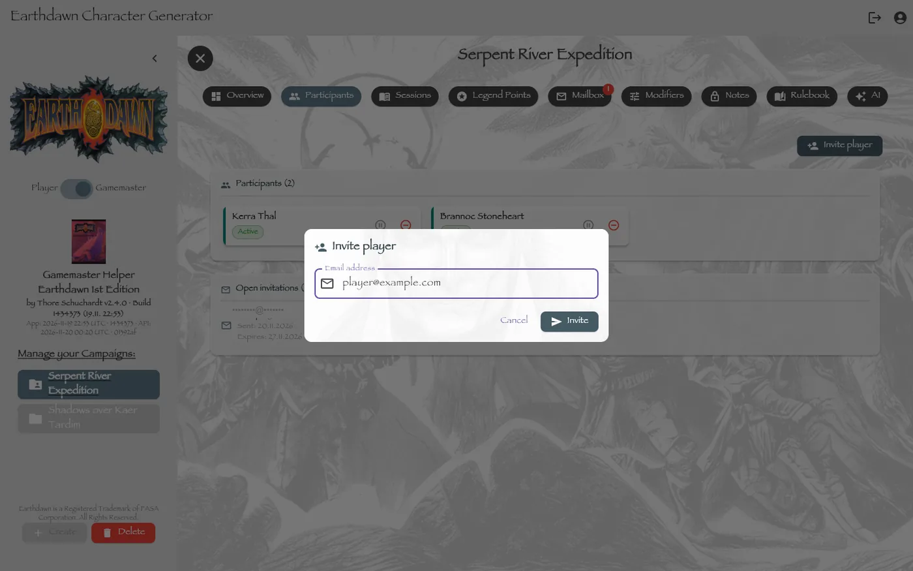
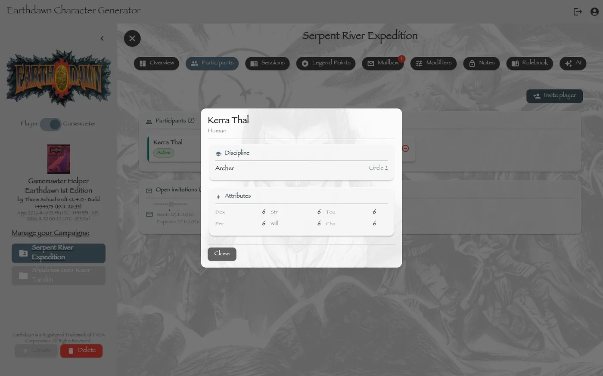
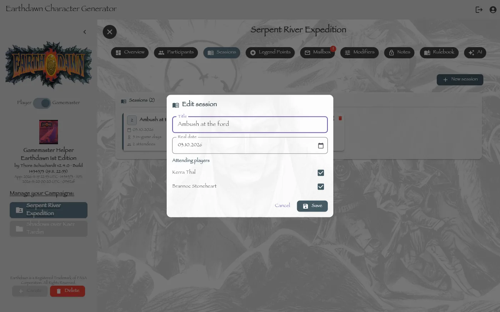
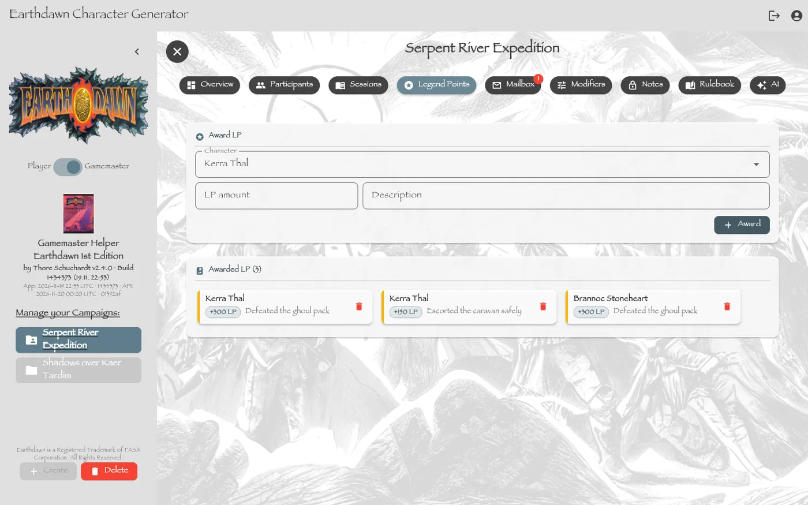
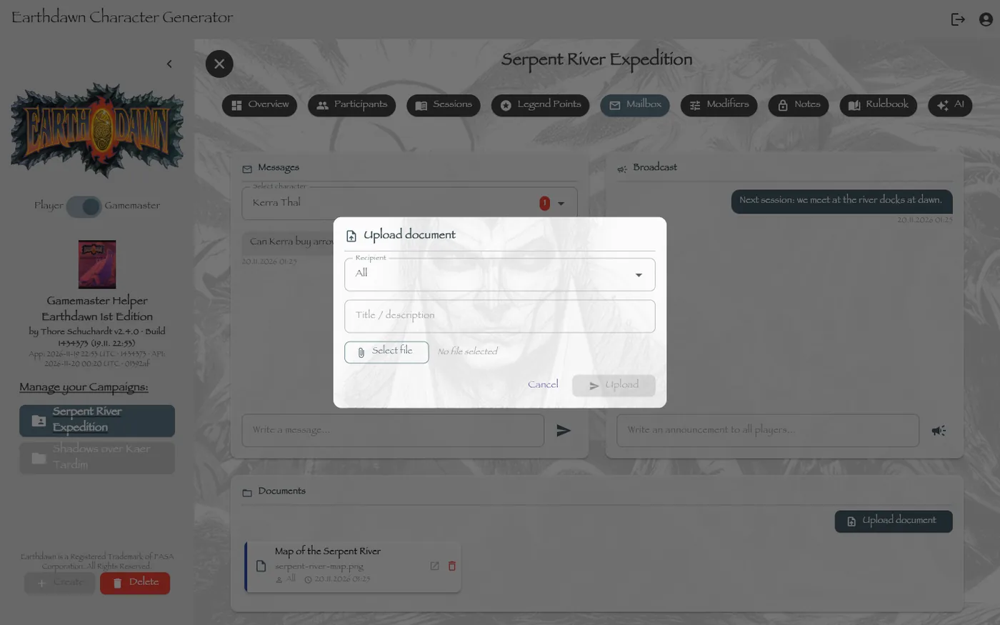
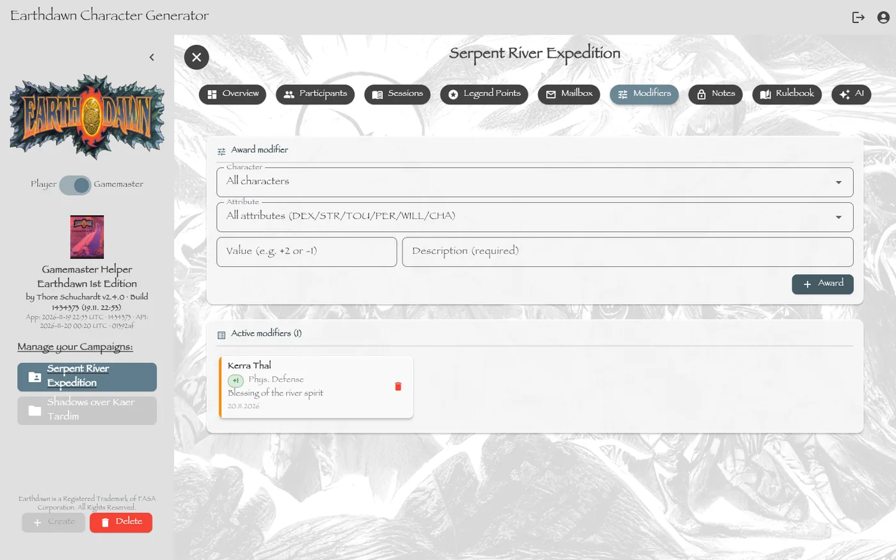
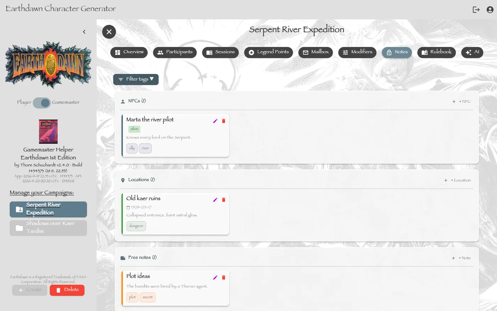

# Game Masters

## Activating game master mode

1. Open your account with the user account icon at the top right.
2. In the section **Gamemaster**, switch on *Do you use the App as DungeonMaster as well?*. The app confirms *Gamemaster activated!*.
3. Back on the main screen, a switch between **Player** and **Gamemaster** appears. Set it to **Gamemaster**.

In game master mode the sidebar shows **Gamemaster Helper Earthdawn 1st Edition** and **Manage your Campaigns:**.

[{ loading=lazy }](../assets/screenshots/en/gm-switch.webp)

## Campaigns

- **Create** opens **Create new Campaign**. Enter the **Campaign name**, choose the start date with **Select Startdate** and click **Create**.
- Click a campaign in the list to open it.
- **Delete** deletes a campaign after you confirm **Delete campaign?**. This cannot be undone.

An open campaign has these tabs: **Overview**, **Participants**, **Sessions**, **Legend Points**, **Mailbox**, **Modifiers**, **Notes**, **Rulebook** and **AI**.

[{ loading=lazy }](../assets/screenshots/en/gm-campaign-tabs.webp)

## Overview

- **Campaign information:** **Real start date**, **Elapsed time**, **In-game start date**, **Elapsed time (in-game)** and **Current in-game date**. **Edit campaign** changes the **Campaign name**, the real start date and **Max. players**.
- **Change start date** sets the in-game start date (**Year**, **Month**, **Day**). **Add days** moves the in-game date forward.
- **Last session:** title and date of the most recent session.
- Counters for **Participants**, **Invitations** and **New messages**.

[{ loading=lazy }](../assets/screenshots/en/gm-overview.webp)

## Participants

### Inviting players

1. Click **Invite player**.
2. Enter the player's **Email address** and click **Invite**. The app confirms **Invitation sent**.
3. The player receives an email with a link and accepts the invitation with one of their characters.

Open invitations appear under **Open invitations** with **Sent:** and **Expires:**. Expired invitations are marked **Expired**; extend them with **Extend deadline**. **Revoke invitation** withdraws an invitation.

[{ loading=lazy }](../assets/screenshots/en/gm-invite.webp)

### Managing participants

The list **Participants** shows each character with **Joined:** and status.

- **Deactivate** and **Activate** switch a participant between active and inactive.
- **Remove from campaign** removes a character after you confirm.
- Characters that have left the campaign are marked **Left**.
- Click a participant to open a quick view of the character with picture, discipline and attributes.

[{ loading=lazy }](../assets/screenshots/en/gm-participants.webp)

## Sessions

- **New session** creates a session with **Title**, **Real date**, **Elapsed in-game days** and **Attending players**.
- The list **Sessions** shows each session with in-game days and attendees. Edit a session with the pencil (tooltip **Edit**) or delete it.
- **Add in-game days** adds in-game days to a session afterwards.

[{ loading=lazy }](../assets/screenshots/en/gm-sessions.webp)

## Legend Points

1. Under **Award LP**, choose a **Character** or **All characters**.
2. Enter the **LP amount** and a **Description**, then click **Award**.

Awarded legend points appear under **Awarded LP** and can be deleted there. Players claim them in their tab **Campaign**. Characters that have left the campaign do not receive legend points.

[{ loading=lazy }](../assets/screenshots/en/gm-legend-points.webp)

## Mailbox

- **Messages:** choose a character with **Select character** to read and answer their chat. In the section **Broadcast**, write an announcement to all players (*Write an announcement to all players...*) and send it with **Send to all players**. Players see it under **Announcements**.
- **Documents:** **Upload document** shares a file. Choose the **Recipient** (one character or **All**), enter a **Title / description**, choose the file with **Select file** and click **Upload**. Players see the documents under **Documents from GM**. Uploaded documents can be deleted again.

[{ loading=lazy }](../assets/screenshots/en/gm-mailbox.webp)

## Modifiers

Modifiers change the attributes of characters, for example as the effect of a curse or a blessing.

1. Under **Award modifier**, choose a **Character** or **All characters**.
2. Choose an **Attribute** or **All attributes (DEX/STR/TOU/PER/WILL/CHA)**.
3. Enter a **Value (e.g. +2 or -1)** and a **Description (required)**, then click **Award**.

Active modifiers are listed under **Active modifiers** and can be deleted there. Players see the modifier on their character with the note *from GM* and the campaign name.

[{ loading=lazy }](../assets/screenshots/en/gm-modifiers.webp)

## Notes

The tab **Notes** collects notes in three sections: **NPCs**, **Locations** and **Free notes**.

- **New** in a section creates a note with **Title**, **Status** (for NPCs), **In-game date**, **Content** and tags (**Add tag**).
- Edit or delete a note with the icons next to it.
- **Filter tags** shows only notes with certain tags. **Reset** clears the filter.

[{ loading=lazy }](../assets/screenshots/en/gm-notes.webp)

## Rulebook

The tab **Rulebook** shows **Rulebook tables** and the same tools as on the character sheet: **Throw Dice** and the search for disciplines, passions, talents and spells. See [Players](spieler.md#dice-and-info-search).

## AI assistant

The AI assistant generates NPCs, dialogs and locations. It uses your own Anthropic API key.

1. In your account, section **AI**, enter your Anthropic API key and click **Save**. You find the key at console.anthropic.com. The section shows **✅ API key on file** once a key is stored. **Delete** removes it.
2. In the campaign, open the tab **AI**. The page **AI Assistant** appears.
3. Choose **NPC**, **Dialog** or **Location**.
4. Optionally enter **Additional hints (optional)**, for example *a blacksmith in Throal, suspicious*.
5. Click **Generate**. The **Result** appears below. **Copy** copies it to the clipboard.

