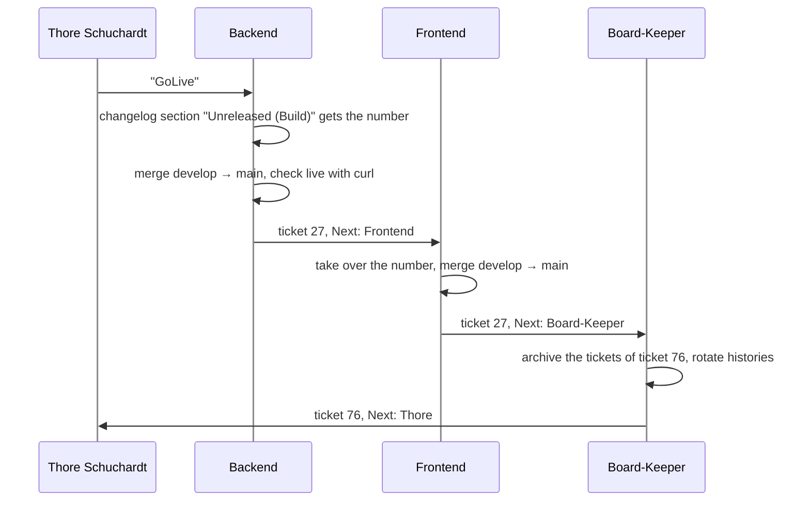

# GoLive

A GoLive brings everything with status "Release" to the live server. Thore Schuchardt triggers it with one word; the instances do the rest and hand over to each other on the board. Why it works this way is described in [ADR 0006](../adr/0006-golive.md) and [ADR 0007](../adr/0007-one-version-per-golive.md).

## Before the GoLive

1. **Release collection.** Every ticket that Thore Schuchardt has confirmed on the build server gets status "Release" and is listed in the release collection ticket 76.
2. **Preparation.** When Thore Schuchardt starts the preparation, the Board-Keeper sets ticket 76 to Next: Testing. Testing checks everything noted there as "check before GoLive" and reports back to Thore Schuchardt.
3. **Version number.** The Board-Keeper assigns the GoLive number (scheme vX.Y.Z, Z increases by one per GoLive) and enters it in ticket 27.

## The GoLive

- **Backend first.** Backend changes are backwards compatible, new frontend versions often need the new backend. The order was reversed after the GoLive of v2.3.12.0 (see [Incidents](incidents.md#golive-v23120-frontend-before-backend)).
- **Only tested code.** Only a state that Testing has checked is merged.
- **GoLive has precedence.** It interrupts the current ticket. Work in progress stays local and is neither pushed nor merged during the GoLive.
- **Live lock.** On the backend side, a push to `main` first deploys to the build server and runs the API test suite. Only if it is green does the live deploy start (see [Testing](testing.md)).
- **Thore Schuchardt merges nothing himself.** "GoLive" is a trigger, not a status.

## After the GoLive

The Board-Keeper moves all tickets of the release into the archive, empties ticket 76 and moves the history of the permanent tickets 27 and 76 into the archive (since 2026-11-19).

The app checks on start and after sign-in whether a newer version is on the server and reloads itself. It shows the GoLive number and a build ID, for example "v2.4.0 · Build …".

## Figures

32 GoLives between 2026-07-02 (v2.1.21.0) and 2026-11-08 (v2.4.0), counted from the backend changelog. See [Facts and figures](facts.md).

## The documentation is separate

This website is published independently of the app. The Docs instance merges to the public branch only when Thore Schuchardt explicitly says "Docs veröffentlichen" (publish docs).
