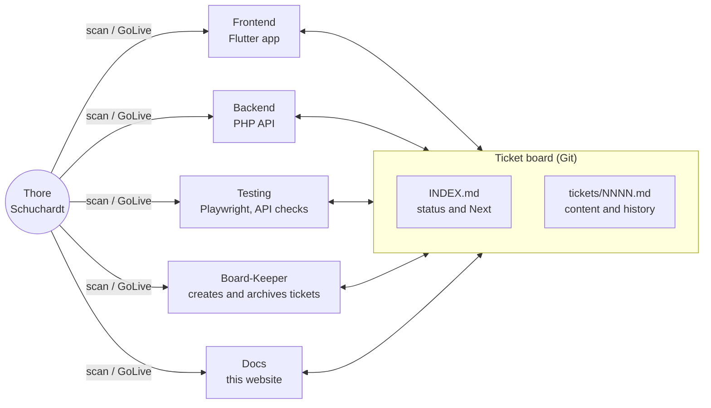

# The setup: five instances

EDChar is built by five Claude Code instances and one person. Each instance has its own folder, its own CLAUDE.md and its own permissions. The instances do not talk to each other. They exchange work only through the ticket board. Thore Schuchardt starts every round and makes every decision (see [ADR 0001](../adr/0001-multiple-agent-instances.md) and [ADR 0002](../adr/0002-control-model.md)).

## The instances

| Instance | Since | Works in | Does | Does not |
|---|---|---|---|---|
| **Frontend** | 2026-06-27 | Flutter repository | Implements the web app, writes unit and widget tests, merges to `main` during a GoLive | Write backend code or make assumptions about backend behaviour |
| **Backend** | 2026-06-27 | PHP repository | Implements the API, maintains the API contract and the changelog, writes the API test suite, starts the GoLive | Write frontend code |
| **Board-Keeper** | 2026-07-02 | Board repository | Creates tickets, records decisions, makes formal corrections, archives tickets after a GoLive, assigns the GoLive number | Change code, work on tickets, merge, decide on ticket content |
| **Testing** | 2026-07-19 | Testing repository | Tests tickets on the build server (UI with Playwright, API calls, CI and test review), records results with evidence, checks before a GoLive | Change app code, test against the live server (except read-only calls without sign-in), archive tickets |
| **Docs** | 2026-11-19 | Documentation repository | Writes this website, reads all other repositories | Write in the code or testing repositories, merge to the public website without an explicit instruction |

Dates: first CLAUDE.md commit of each instance (counted, see [Facts and figures](facts.md)).

## How they work together

- **Only through the board.** Each instance updates only its own tickets: its line in the index and new entries in the ticket file. Everything else goes through the Board-Keeper. See [Ticket workflow](workflow.md).
- **Own clone of the board.** Since 2026-11-06 Frontend and Backend each work in their own clone of the board repository, Docs since its start. Before that, Frontend and Backend shared one folder.
- **Repository boundaries.** No instance writes into another instance's repository. If a change needs the other side, the ticket says so and the Board-Keeper creates a ticket for that side.
- **Rounds, not events.** An instance starts when Thore Schuchardt sends `scan`. It then works through all tickets with its name in the "Next" field and reports at the end (since 2026-11-06).
- **Gates.** Code reaches the live server only after a green CI run, a check by Testing, acceptance by Thore Schuchardt and a GoLive. See [Testing](testing.md) and [GoLive](golive.md).

## Environments

| Environment | Address | Fed by |
|---|---|---|
| Build | build.edchar.schuchi.eu | every push to `develop` |
| Live | edchar.schuchi.eu | a merge to `main`, only during a GoLive |
