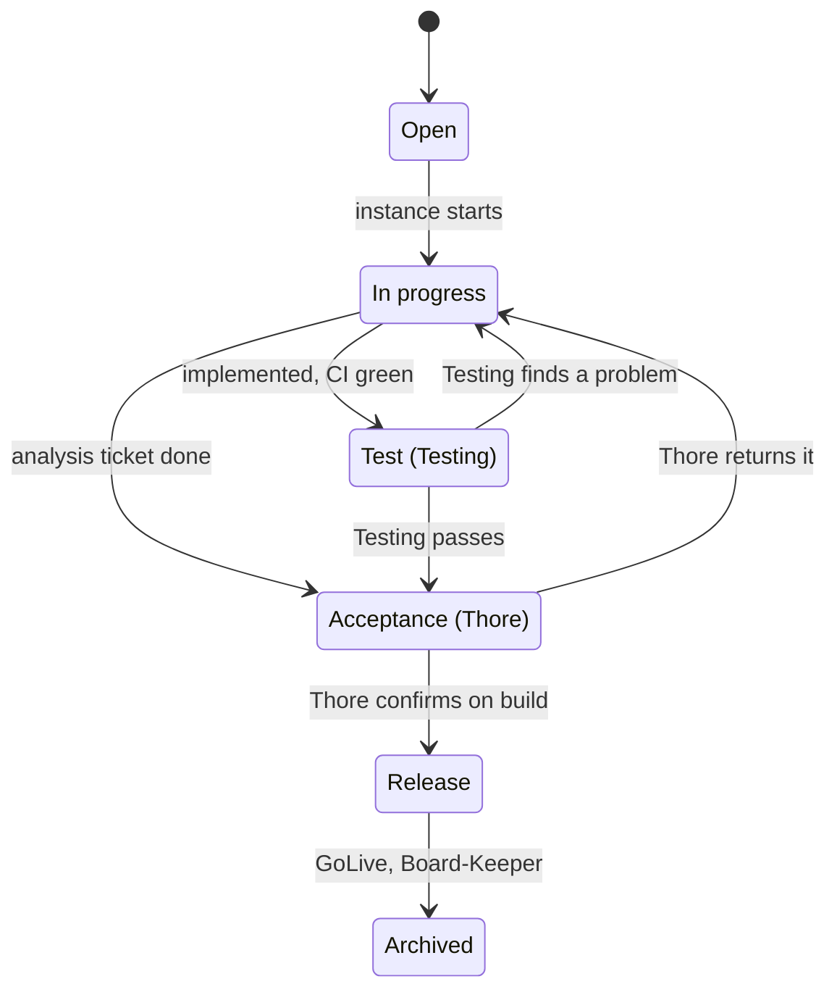

# Ticket workflow and the "Next" field

The ticket board is a set of Markdown files in its own Git repository (see [ADR 0003](../adr/0003-markdown-board-in-git.md)). It is the only channel between the instances.

## Structure of the board

Since 2026-11-19:

| File | Content |
|---|---|
| `INDEX.md` | One line per active ticket: number, title, status, repository, Next, priority, test approach, blocked by. The only source for these fields. |
| `tickets/NNNN.md` | Context, task, acceptance criterion, out of scope, cross-repository note, open question, and the history of the ticket. No status fields. |
| `archiv/` | Archived tickets and rotated histories of the permanent tickets. |
| `PROTOKOLL.md` | The rules of the board. |

Until 2026-11-19 the whole board was a single file, which had grown to 226 KB.

## Lifecycle

- **Release** means: confirmed on the build server, not live yet. Only Thore Schuchardt sets it. The ticket is then added to the release collection ticket 76.
- **Archived** happens only after the go-live, and only by the Board-Keeper.
- Tickets 27 (versions and changelog) and 76 (release collection) are permanent tasks and never archived.

How the lifecycle grew is described in [ADR 0004](../adr/0004-ticket-lifecycle.md).

## The "Next" field

"Next" names who should look at the ticket next: Frontend, Backend, Testing, Board-Keeper, Docs, Thore, or "–" if nobody is needed. Every instance sets it when it finishes a step. An instance that waits for work reacts only to tickets that carry its own name.

A typical ticket that touches both sides moves like this:

1. Board-Keeper creates it: Open, Next: Backend.
2. Backend implements its part: In progress, then Next: Frontend.
3. Frontend implements its part: Test (Testing), Next: Testing.
4. Testing checks it on build: Acceptance (Thore), Next: Thore.
5. Thore Schuchardt confirms it: Release.
6. GoLive, then the Board-Keeper archives it.

[One ticket, end to end](end-to-end.md) shows a real example.

## Rules for every instance

- **Pull before every change.** Commit and push immediately after it. The line in the index and the ticket file go into the same commit.
- **Only the own line.** An instance changes only its own tickets in the index. New tickets and all other changes are the Board-Keeper's job.
- **Findings as new entries.** Results and notes are added at the top of the ticket's history, in the form `**<Instance>-Update (date):** …`.
- **Check before changing status.** Right before an instance changes a ticket's status, it pulls again and re-reads the ticket file, in case the task or the acceptance criterion has changed in the meantime.
- **Do not guess.** When something is unclear, the question goes into the ticket and Next becomes Thore.
- **Priority** (high, medium, low, very low) decides the order. With equal priority the instance decides itself. "Very low" tickets are only worked on with a concrete reason or explicit approval.
- **Test approach** (UI, API, unit, analysis) tells Testing how to check the ticket. Analysis tickets go directly to acceptance.

## The `scan` command

Thore Schuchardt starts a round by sending `scan` to an instance. The instance pulls the board, reads the index, lists the tickets with its name in the "Next" field by priority and starts with the highest without asking. It keeps working until no ticket is left for it. At the end it reports: finished tickets, open questions with ticket numbers, and blockers.
